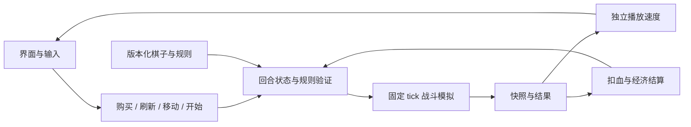
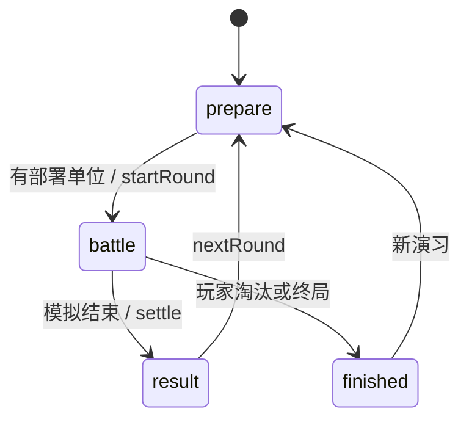

# 开发框架与技术方案

## 技术决策

以 TypeScript 严格模式承载规则、Vite 提供开发/构建。首版使用 DOM/CSS 棋盘，原因是单位规模小，布局与交互可直接验证，且无需引入引擎依赖。游戏核心不依赖 DOM，后续替换 PixiJS 或 Three.js 只需要替换表现层。

当前工程配置锁定 TypeScript 5.9 与 Vite 7 主版本范围；实际安装版本以 package-lock.json 为准。推荐 Node 22.12+ 或 24，当前在 Node 24 验证。[Vite 官方指南](https://vite.dev/guide/)；[TypeScript 模块说明](https://www.typescriptlang.org/docs/handbook/2/modules.html)。

## 当前目录和职责

```text
src/
  data/units.ts       棋子定义、规则常量、商店概率、经验表、羁绊定义
  engine/types.ts     Game / Player / Piece / Fighter / Frame / Battle
  engine/random.ts    显式种子伪随机数
  engine/game.ts      商店、卡池、合成、布阵、经济、AI、回合结算
  engine/synergies.ts 不同棋子去重计数和阈值判定
  engine/battle.ts    战斗副本、寻路、攻击、技能、伤害、帧快照
  main.ts            UI 事件桥接、选中状态、回放定时器、界面渲染
  style.css          响应式战术界面
tests/engine.test.ts  经济、卡池、升星、布阵和模拟的必要模块测试
docs/                资料与方案
```

依赖方向：UI → game/battle → data/types；引擎不反向依赖 UI。`main.ts` 当前是原型集成入口，正式扩展时再拆为 Board / Shop / Bench / Hud / Codex，不提前引入空壳组件。



## 状态机与事务边界



- 所有经济和部署命令校验 `phase`，战斗期间拒绝购买、出售、移动、刷新和买经验。
- 商店占用卡池份额；刷新归还旧商店后重抽；购买把占用转为持有；出售按星级对应份数归还。
- 合成保留场上单位位置，删除另两枚，递归处理下一星。备战席满时仅允许能即时合成的购买。
- 模拟只使用克隆出来的 Fighter，永不扣除阵容 Piece 的生命或改写其位置。
- settle 只允许从 battle 执行一次，防止重复金币与扣血。
- 结算完成后才刷新下一轮商店，锁定的商店保留。

## 战斗实现

逻辑步长 0.25 秒，最多 160 tick（40 秒）；展示可 1×/2×/4× 播放，不影响结果。按曼哈顿距离选择最近目标，使用 BFS 绕开阻挡找到攻击位置。每 tick 轮换行动先后方向，降低固定先手偏差。单位累积能量到 100 后触发原型统一强化攻击。超时算平局，双方各自防守按平局扣血。

当前一次计算全部快照，再播放，规模上限约 20 单位×161 帧。后续应把战斗放入 Web Worker，传递事件流或稀疏快照，动画在 UI 层插值。固定 tick 不等于所有浏览器逐位完全一致；联网版需要服务器权威结算。

## 数据模型扩展

- `UnitDef` 是静态配置；`Piece` 是持有实例（uid、defId、star、position）；`Fighter` 是单场战斗副本。
- 后续增加 `AbilityDef`（trigger/target/effects/cooldown）与 `Effect` 判别联合类型（damage/heal/shield/stun/summon/mana 等），禁止从数据执行 JS。
- `ItemDef` 与装备实例明确归属、可拆卸时点与合成规则。
- 每个版本目录包含 units/traits/skills/items/shop/economy 及 manifest；字段级证据区分 confirmed、inferred、prototype、unknown。
- 数据校验要求 ID 唯一、引用存在、概率归一、价格及生命合法、技能目标类型兼容。未确认的历史值不直接投产。

## 多人服务方案（尚未实现）

单机 Game 可提炼为 shared 包；Node.js 服务端维护 8 人房间、准备倒计时和统一随机种子，通过 WebSocket 接收带序号的命令并校验金币、阶段、位置、卡池。客户端只做表现和输入反馈，服务端计算战斗与结算。

协议建议：`joinRoom / ready / buy / sell / move / reroll / buyXp / lock`；下行 `snapshot / commandAck / phaseChanged / battleFrames / roundResult`。每条指令含 roomId、playerId、sequence、expectedRevision，服务端保证去重和顺序。断线重连获取最新 snapshot 与当前回放 tick。匹配、认证和房间持久化在玩法稳定后加入。

## 验证与性能

只跑必要的 engine 模块测试和生产构建，不跑全仓全量测试。重点检查共享卡池守恒、金币非负、合成数量、部署上限、重复结算、同输入战斗一致和生命归零。浏览器检查购买→部署→战斗→结算的真实操作链以及窄屏布局。

性能目标（待测量）：桌面 UI 交互响应 <100ms；战斗计算不长时间阻塞输入；移动端不裁切棋盘。正式版本改为局部 DOM 更新或组件渲染，避免每个播放 tick 整页重建。
